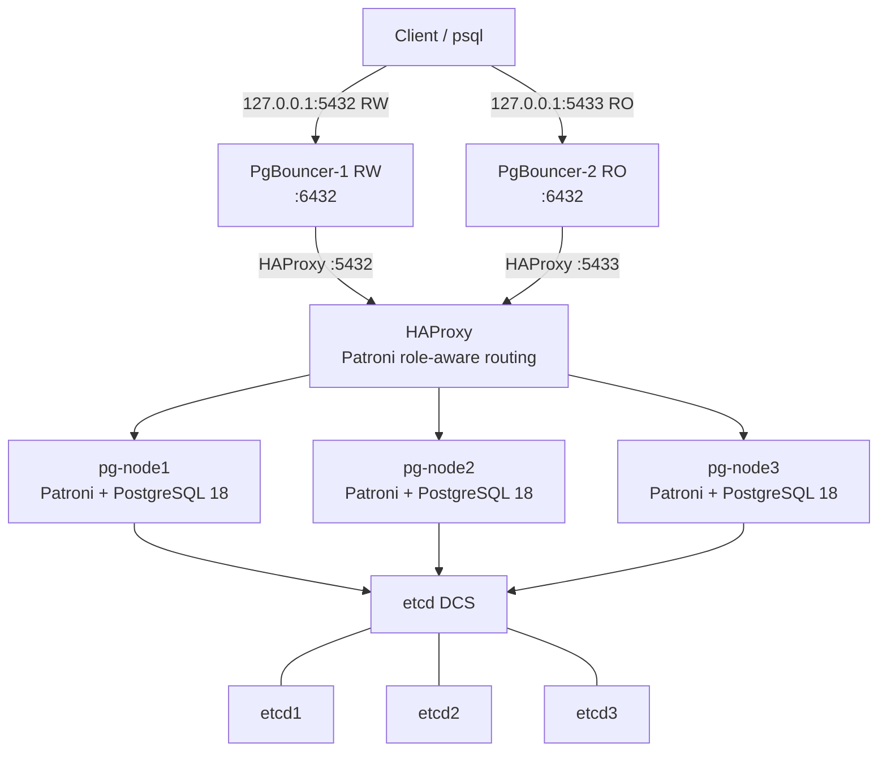

# PostgreSQL 18 HA, Replication, Routing & Connection Pooling Lab

A portfolio-grade local lab for building a small PostgreSQL high-availability platform from first principles with **PostgreSQL 18**, **Patroni**, **etcd**, **physical streaming replication**, **HAProxy**, **PgBouncer**, **Docker Compose**, and **Docker secrets**.

The project exposes separate client endpoints for read/write and read-only traffic while keeping PostgreSQL itself private to the Docker network.

> **Current architecture:** PostgreSQL HA is managed by Patroni. Patroni owns initialization, replication lifecycle, role management, leader election and promotion. A three-member etcd cluster provides the DCS, while HAProxy discovers primary/replica roles through Patroni's REST API.

The topology contains three role-neutral PostgreSQL services: **`pg-node1`**, **`pg-node2`**, and **`pg-node3`**. Patroni makes their database roles dynamic, so a node name identifies a host rather than permanently identifying a primary or replica.

## What this project demonstrates

- PostgreSQL 18 on Debian with three role-neutral database nodes
- Patroni-managed PostgreSQL initialization, replication lifecycle, leader election and promotion
- Three-member etcd v3 distributed configuration store
- Physical streaming replication between PostgreSQL members
- Standalone PostgreSQL 18 subscriber for logical replication experiments
- Patroni REST API health and role discovery
- HAProxy routing designed around Patroni role-aware health checks
- PgBouncer transaction pooling
- SCRAM-SHA-256 authentication
- Docker secrets instead of committed passwords
- Persistent PostgreSQL and etcd data volumes
- Docker health checks and dependency ordering
- Repeatable failover and recovery experiments

## Architecture



PostgreSQL node names are deliberately **role-neutral**. Patroni determines which member is primary and which members are replicas. HAProxy can query Patroni's REST API on port `8008` to route new connections according to the current role.

### Client endpoints

| Host endpoint | Path | Purpose |
|---|---|---|
| `127.0.0.1:5432` | PgBouncer-1 → HAProxy `:5432` → current Patroni primary | Read/write |
| `127.0.0.1:5433` | PgBouncer-2 → HAProxy `:5433` → healthy Patroni replicas | Read-only |
| `127.0.0.1:5435` | Standalone `pg-subscriber` PostgreSQL instance | Logical replication target |
| `127.0.0.1:8404/stats` | HAProxy statistics listener | Monitoring |
| `127.0.0.1:8080` | NGINX → Python app → HAProxy `:5432` → current Patroni primary | Task list app |

There is deliberately **no port `5434` / PgBouncer-3 endpoint**. Clients address roles rather than physical nodes, so the topology remains valid after failover.

### Logical subscriber (first stage)

The `pg-subscriber` service is a separate PostgreSQL 18 instance on `pgnet`, outside Patroni. Its data persists in `pg_subscriber_data`. Start it with:

```bash
make secrets
docker compose up -d pg-subscriber
docker compose ps pg-subscriber
export PGPASSWORD="$(cat secrets/postgres_password.txt)"
psql -h 127.0.0.1 -p 5435 -U postgres -d postgres -c 'SELECT pg_is_in_recovery();'
```

The result should be `f`: this is an independent writable server, not a physical standby. No publication, subscription, or sample tables are created automatically. To set up logical replication, first configure `wal_level=logical` in the **running Patroni cluster configuration** (and ensure sufficient replication slots and WAL senders), then create a test table and publication on the publisher, matching schema on this subscriber, and a subscription pointing at HAProxy's internal **RW** endpoint `haproxy:5432`. Connect directly to HAProxy for the subscription; transaction pooling through PgBouncer is unsuitable for the replication connection. Plan and test logical slot failover separately before treating a Patroni switchover as seamless for this subscriber.

### Component responsibilities

| Component | Responsibility |
|---|---|
| PostgreSQL 18 | Database engine, WAL generation and physical streaming replication |
| Patroni | PostgreSQL lifecycle, cluster membership, leader election, promotion and role management |
| etcd | Consensus-backed distributed configuration store used by Patroni |
| HAProxy | Routes database connections according to backend health and Patroni role |
| PgBouncer | Client connection pooling |
| Docker Compose | Container, network, volume, secret and dependency orchestration |

A key design principle is separation of responsibilities: **PgBouncer manages connections, HAProxy routes traffic, Patroni manages PostgreSQL roles, and etcd provides consensus state.**

## Prerequisites

- Docker Engine with Docker Compose v2
- `psql` client on the host for `scripts/verify.sh`
- `openssl` for automatic secret generation
- Optional: `make` and `shellcheck`

Verify:

```bash
docker --version
docker compose version
psql --version
```

## Quick start

```bash
git clone https://github.com/andrasfeher/postgresql-replication-routing-lab.git
cd postgresql-replication-routing-lab

make secrets
make up
```

Without `make`:

```bash
./scripts/init-secrets.sh
docker compose up -d --build
```

Wait until the containers are healthy:

```bash
docker compose ps
```

Then run the end-to-end verification:

```bash
make verify
```

## Connect

### Web task list

Open http://127.0.0.1:8080 after `make up`, or start the web service explicitly:

```bash
docker compose up -d --build nginx
curl --fail http://127.0.0.1:8080/
```

The index page lets you add tasks, edit their titles, mark them completed (then
click **Save**), and delete them. Tasks are stored in `public.tasks` in the
`todo` database. The `web-init` service initializes the database and schema before
the web service starts.
The existing PostgreSQL volumes persist tasks across web container restarts.

The app uses the restricted `webapp` login, its own `webapp_password` secret,
and HAProxy's primary endpoint for every
request, so new connections follow primary changes. During database outages it
returns HTTP 503. If a save is interrupted, check the list before submitting again.
Unauthenticated visitors are redirected to `/login`, which links to `/register`.
Register with an email address and a 12–128 character password. Email syntax is
validated on the server, addresses are normalized to lowercase, and duplicates
are rejected. Registration sends a verification link and leaves the account
inactive until the user confirms the link. Links expire after one hour and can
only be used once; visiting a link displays a confirmation button so email link
scanners cannot activate accounts automatically.

For this local lab, emails are captured by Mailpit rather than delivered to real
mailboxes. Open [the local inbox](http://127.0.0.1:8025), open your verification
email, follow its link, and click **Verify email**, then log in. If a link expires,
log in with your email and password to send another link (at most once per minute).
Existing accounts must verify too; their tasks and passwords are retained.
Mailpit is configured in `compose/web.yaml`; SMTP traffic stays on `pgnet`.

Authentication data lives in `todo.public.users`, `todo.public.sessions`, and
`todo.public.email_verifications`. Verification tokens are stored as hashes.
Passwords use salted PBKDF2-SHA256 hashes (600,000 iterations); only hashes of
random session tokens are stored. Sessions expire after 24 hours and logout revokes
them. Cookies use HttpOnly and SameSite=Strict, and forms have CSRF protection.
Each user has a private task list. Task reads, updates, and deletes are scoped to
the authenticated user, and new tasks are assigned to that user on the server.
`tasks.user_id` is required (`NOT NULL`) and references `users.id`. The schema
upgrade removes legacy tasks that have no owner before enforcing the constraint. The app is served
on localhost over HTTP for this lab.

For an older installation that still has `postgres.public.todo_tasks`, migrate
before rebuilding the web container. This preserves IDs, completion state, creation
times, and the identity sequence, verifies the copy, and removes the old table:

```bash
docker compose stop web
docker compose run --rm --no-deps -T web-init python3 < web/migrate_to_todo.py
docker compose up -d --no-deps --build web
docker compose up -d --no-deps nginx
```

Run the live smoke test (creates and deletes its own temporary account and task):

```bash
docker compose exec -T -e APP_TEST_URL=http://nginx:8080 web python3 < web/tests/smoke.py
```

### SQL connections

The generated PostgreSQL password is stored locally in `secrets/postgres_password.txt` and is excluded from Git.

```bash
export PGPASSWORD="$(cat secrets/postgres_password.txt)"

# Read/write endpoint -> current Patroni primary
psql -h 127.0.0.1 -p 5432 -U postgres -d postgres

# Read-only endpoint -> a healthy Patroni replica
psql -h 127.0.0.1 -p 5433 -U postgres -d postgres

```

Confirm the target role:

```sql
SELECT pg_is_in_recovery();
```

Expected result:

- port `5432`: `false` — primary
- port `5433`: `true` — standby

## Patroni and role verification

Each node receives a node-specific configuration from `patroni/`, mounted as `/etc/patroni/patroni.yml`. Passwords remain outside Git and are passed from Docker secrets by `scripts/patroni-entrypoint.sh`.

Inspect cluster membership and roles with:

```bash
docker exec -it pg-node1 \
  patronictl -c /etc/patroni/patroni.yml list
```

Do not assume `pg-node1` will always be primary. To inspect a node directly:

```bash
docker exec -it pg-node1 \
  runuser -u postgres -- \
  psql -c "SELECT pg_is_in_recovery();"
```

`false` means primary; `true` means replica.

## Verify streaming replication

On whichever node Patroni currently reports as primary:

```sql
SELECT application_name, client_addr, state, sync_state
FROM pg_stat_replication;
```

With two healthy asynchronous replicas, the primary should normally report two streaming replication connections.

Create a simple test object through the RW endpoint:

```bash
psql -h 127.0.0.1 -p 5432 -U postgres -d postgres <<'SQL'
CREATE TABLE IF NOT EXISTS lab_replication_test (
    id bigint GENERATED ALWAYS AS IDENTITY PRIMARY KEY,
    created_at timestamptz NOT NULL DEFAULT now(),
    note text NOT NULL
);
INSERT INTO lab_replication_test(note) VALUES ('written through the RW endpoint');
SQL
```

Read it through the RO endpoint:

```bash
psql -h 127.0.0.1 -p 5433 -U postgres -d postgres \
  -c "TABLE lab_replication_test;"
```

## PgBouncer monitoring

```bash
psql -h 127.0.0.1 -p 5432 -U postgres -d pgbouncer -c "SHOW POOLS;"
psql -h 127.0.0.1 -p 5432 -U postgres -d pgbouncer -c "SHOW STATS;"
```

The pool mode is `transaction`, so session-scoped PostgreSQL features must be evaluated carefully before using this configuration for an application.

## HAProxy monitoring

Open the local statistics page:

```text
http://127.0.0.1:8404/stats
```

The stats listener is deliberately bound to localhost by Docker Compose.

## Stop or reset

Stop containers but keep PostgreSQL data/configuration:

```bash
make down
```

Delete the containers **and all PostgreSQL lab data**:

```bash
make reset
```

## Repository layout

```text
.
├── .github/workflows/ci.yml
├── Dockerfile
├── Makefile
├── compose.yaml
├── compose/
│   ├── etcd.yaml
│   ├── haproxy.yaml
│   ├── pgbouncer.yaml
│   ├── postgres.yaml
│   └── subscriber.yaml
├── docs/
│   ├── ARCHITECTURE.md
│   ├── PORTFOLIO.md
│   └── TROUBLESHOOTING.md
├── haproxy/
│   └── haproxy.cfg
├── patroni/
│   ├── patroni-node1.yml
│   ├── patroni-node2.yml
│   └── patroni-node3.yml
├── pgbouncer/
│   ├── entrypoint.sh
│   ├── pgbouncer-1.ini
│   └── pgbouncer-2.ini
├── scripts/
│   ├── check.sh
│   ├── init-secrets.sh
│   ├── patroni-entrypoint.sh
│   └── verify.sh
└── secrets/
    ├── postgres_password.example
    └── replication_password.example
```

## Design notes and limitations

The original lab assigned roles statically: `pg-node1` was primary and `pg-node2`/`pg-node3` were standbys. The Patroni iteration removes that assumption. Patroni owns PostgreSQL initialization, replica cloning, start/stop operations, leader election and promotion.

HAProxy uses Patroni's role-aware REST endpoints rather than static node roles:

```text
RW backend -> Patroni /primary -> current primary
RO backend -> Patroni /replica -> healthy replicas
```

HAProxy does **not** elect or promote a primary; it reacts to the state managed by Patroni and etcd.

This remains an educational architecture lab rather than a drop-in production HA platform. Important limitations and learning points include asynchronous replication's potential data-loss window, application reconnect/retry requirements during failover, etcd quorum as part of the availability model, PgBouncer transaction-pooling semantics, and the absence of production fencing/watchdog design.

For the reasoning behind the topology and its trade-offs, read [docs/ARCHITECTURE.md](docs/ARCHITECTURE.md).

## Failover model

A node name is not a database role. If the current primary fails, Patroni uses etcd-backed state to elect and promote an eligible replica. HAProxy's `/primary` and `/replica` checks update backend eligibility automatically. New RW connections go to the promoted primary, while RO connections continue to use healthy replicas.

Automatic failover does not preserve an in-flight transaction; applications still need appropriate reconnect and transaction-retry behavior.

## Patroni failover exercises

Useful Patroni HA exercises include:

1. verify one primary and two replicas with `patronictl`;
2. stop the current primary and observe Patroni leader election;
3. verify HAProxy routes new RW connections to the promoted node;
4. restart the old primary and observe it rejoin as a replica;
5. stop one etcd member and confirm the DCS retains quorum;
6. test client and in-flight transaction behavior during failover;
7. measure failover time and document the observed RTO and RPO implications.

## Security

This repository is designed for a **local lab**:

- database and stats ports are bound to `127.0.0.1` by default;
- PostgreSQL and replication passwords are Docker secrets stored in ignored local files;
- Patroni configuration files contain no real passwords;
- generated PgBouncer authentication data is created inside the container at startup;
- no real credentials should ever be committed.

See [SECURITY.md](SECURITY.md) before exposing any component outside your workstation.

### Web application database permissions and backups

`make secrets` generates `secrets/webapp_password.txt`. Only `web-init` receives
both administrator and application credentials; `web` receives only the application
credential. The `webapp` role has SELECT, INSERT, UPDATE, and DELETE on public
tables in `todo`, plus schema USAGE, database CONNECT, and sequence USAGE.
It cannot create schemas, permanent or temporary tables, alter/drop existing
tables, or truncate them. Objects remain owned by `postgres`. Default grants cover
future public tables and sequences created by `postgres`; migrations by another
owner must configure that owner's default privileges separately.

Schema changes belong in `web/schema.sql` and run through `web-init`, not request
handlers. Initialization fails rather than deleting legacy tasks without owners.
Revoking PUBLIC database TEMPORARY and schema CREATE also affects other roles
that previously relied on those public privileges in `todo`.

Create a backup including ownership, ACLs, default privileges, and role definitions:

```bash
./scripts/backup-todo.sh
```

The output is stored under ignored `.tmp/backups/`. `todo.dump` contains the
complete database, including grants; `roles.sql` contains cluster role definitions
and password verifiers. Keep both files private. Restore roles first, then use
`pg_restore --create` as an administrator. On a target with existing roles, reconcile
role creation statements first (especially the pre-existing `postgres` role).
Do not use `--no-owner` or `--no-acl` if preserving permissions.

### Secured Patroni management API

Patroni listens only on its address in the internal `patroni_mgmt` Docker network
(`172.30.80.0/24`). No management port is published. Web, Mailpit, PgBouncer,
subscriber, and Ansible containers are not attached to this network. Database
traffic still uses `pgnet`; PostgreSQL transport remains a separate TLS hardening item.
Etcd now uses mutual TLS and a separate coordination network (see below).

`make secrets` creates a local management CA, one server certificate per node,
and `secrets/patroni_api_password.txt`. Private keys and API credentials are ignored
by Git and Docker build contexts. The CA private key is never mounted in a
container. Server certificates expire after 365 days; the CA expires after 10 years.
For renewal, securely retain the CA, replace each node certificate/key pair using
its matching management SAN, and recreate that node in a rolling maintenance
operation. The generator preserves existing pairs and rejects invalid/expired
certificates; it does not automatically rotate them.

All API traffic uses HTTPS. HAProxy validates the CA and each node's hostname for
health checks; PostgreSQL forwarding remains plain TCP. Patroni and patronictl
verify certificates using the configured CA. Safe GET checks need no API password.
Unsafe methods require Basic authentication with the `patroni-admin` account and
an allowed source address. The allowlist includes the opt-in admin container
(`172.30.80.30`) and registered cluster members; HAProxy (`172.30.80.20`) is excluded
from unsafe calls. Loopback is listed for local tools, although the listener binds
to the management interface. Administrative credentials are loaded from secrets.
TLS client certificates are not required; access is controlled by server-verified
TLS, Basic authentication for unsafe methods, the allowlist, and network isolation.

Use the dedicated admin container (one at a time because its address is fixed):

```bash
docker compose --profile admin build patroni-admin
docker compose --profile admin run --rm --no-deps patroni-admin list
# Example maintenance command, only when a switchover is intended:
# docker compose --profile admin run --rm --no-deps patroni-admin switchover
```

Verify authentication and certificate validation with:

```bash
docker compose --profile admin run --rm --no-deps -T \
  --entrypoint /opt/patroni/bin/python patroni-admin - < test/security/patroni_admin.py
```

The test issues authenticated configuration reloads without changing configuration
or leadership. Docker administrators remain trusted: they can attach containers to
networks or read mounted secrets. The existing Ansible Docker socket access is
therefore still a separate privileged administrative capability.

### Secured etcd coordination

Etcd client and peer listeners use mutual TLS on the dedicated internal
`coordination` network. Patroni authenticates with its own client certificate and
a password, with read/write permission only under `/service/postgres-lab/`.
Read-only health and certificate-only root administration use separate identities.
No etcd endpoint is attached to the application network or published on the host.

See [etcd security and administration](docs/ETCD-SECURITY.md) for the access model,
startup dependencies, administration commands, tests, certificate rotation, and
migration/recovery record. Each Docker context now includes only explicitly
allowlisted source files, excluding backups and secrets regardless of extension.

### NGINX frontend

The browser entry point remains <http://127.0.0.1:8080>. NGINX owns that published
port and proxies to the internal Python service over `web_frontend`
(`172.30.82.0/24`). Python has no host-published port. NGINX joins the internal frontend network and its own `web_edge` bridge
for host port publishing, receives no database secrets, and cannot directly access database
or coordination services. It runs as UID/GID 101 with a read-only filesystem,
a temporary writable `/tmp`, no Linux capabilities, and no privilege escalation.

NGINX buffers request bodies, caps them at 8 KiB, and applies header/body idle
limits, upstream timeouts, per-client request and connection limits, and a global
64-request connection limit. These are bounded-resource controls, not a promise
that every request finishes within a fixed total duration. Upstream DNS is refreshed
through Docker DNS so recreating the web container does not require restarting
NGINX. Failed application requests are not automatically replayed.

The Python backend independently caps active request threads at 64 and uses
10-second socket idle timeouts. Client-IP headers are accepted only from NGINX's
fixed `172.30.82.20` address; NGINX overwrites incoming forwarding headers.
Access logs omit query strings, and NGINX error logging is disabled specifically
for `/verify` to avoid exposing verification tokens in upstream error messages.

This local configuration preserves HTTP. HTTPS termination, trusted browser
certificates, and Secure session cookies remain a separate change.

```bash
docker compose exec -T web python3 < web/tests/http_server.py
docker compose exec -T -e APP_TEST_URL=http://nginx:8080 web python3 < web/tests/smoke.py
docker compose exec -T web python3 < test/security/nginx_proxy.py
docker compose exec nginx nginx -t
```

`web/tests/smoke.py` defaults to direct localhost access when `APP_TEST_URL` is
omitted. Set that variable as above to exercise the public proxy path from inside
the web container. Verification emails continue using the unchanged browser URL.
