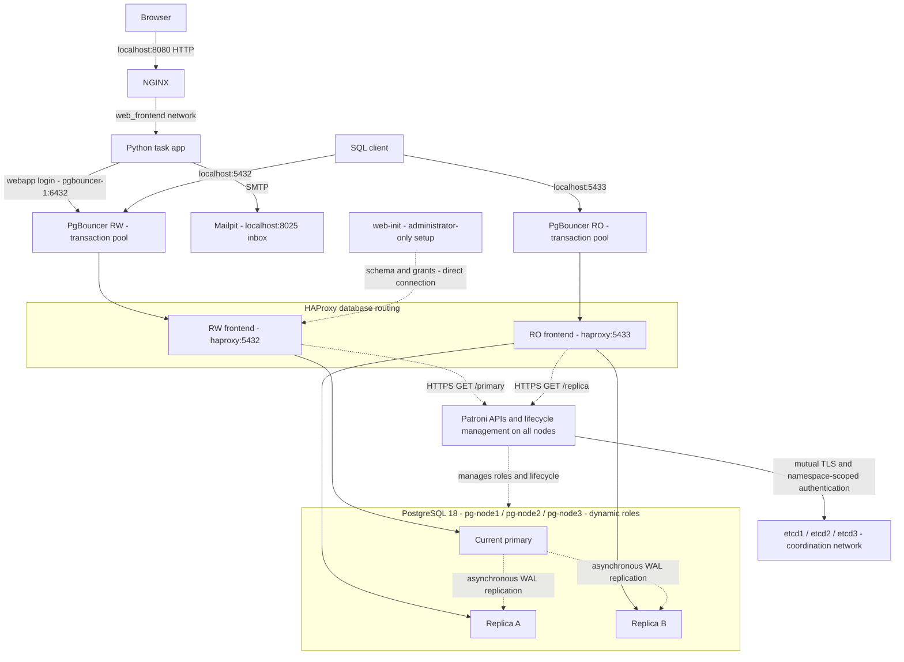

# Architecture and design decisions

## Goals and responsibilities

The lab separates the browser edge, application behavior, connection pooling,
database routing, PostgreSQL lifecycle, and coordination state. Each layer has a
distinct role: NGINX handles HTTP proxying and request limits; Python implements
authentication and per-user tasks; PgBouncer pools connections; HAProxy routes by
database role; Patroni manages PostgreSQL; and etcd provides consensus-backed state.

## Current architecture



The three physical members are `pg-node1`, `pg-node2`, and `pg-node3`. Any member
may become primary; the diagram's primary and replica boxes represent roles,
not permanent node assignments. Mailpit captures development mail. The separate
`pg-subscriber` instance is outside Patroni and has no automatic subscription.

## Request paths

### Web application and database writes

```text
Browser -> localhost:8080 -> NGINX
  -> web:8080 on web_frontend
  -> pgbouncer-1:6432 using webapp
  -> haproxy:5432
  -> current PostgreSQL primary:5432
```

The app uses the RW pooler for all database requests, including reads used by
login and task-list pages. This keeps application reads on the primary rather
than introducing replica lag into authentication or read-after-write behavior.
NGINX has no database secrets or database/coordination network membership. Python
has no host-published port and receives only its restricted application password.

### SQL client read/write and read-only endpoints

```text
localhost:5432 -> PgBouncer RW:6432 -> HAProxy:5432 -> current primary
localhost:5433 -> PgBouncer RO:6432 -> HAProxy:5433 -> a healthy replica
```

The RO endpoint routes to physical replicas; it is not a separate read-only
application role or SQL authorization mechanism. Clients still authenticate
with their configured PostgreSQL roles.

### Administrator-only schema initialization

```text
web-init -> haproxy:5432 -> current primary
```

`web-init` deliberately bypasses transaction pooling for database/schema setup,
role configuration, and grants. It runs to completion before the web service
starts. Runtime request handlers do not initialize the schema or receive
administrator credentials. Existing legacy tasks without owners require an
explicit migration; initialization fails rather than deleting them.

## Routing, pooling, and failover

HAProxy exposes internal RW and RO frontends. It uses certificate- and
hostname-verified HTTPS requests to each node's Patroni API: `/primary` selects
the current primary and `/replica` selects healthy replicas. HAProxy does not
elect or promote a node; it observes roles assigned by Patroni and changes
backend eligibility accordingly. Docker DNS refresh handles container address
changes.

Both PgBouncer instances use transaction pooling. The RW pooler authenticates
`webapp` as well as the existing administrator account; the RO pooler does not
receive the application password. The app has no PgBouncer administrative rights.
The `webapp` role's database-specific default sets `statement_timeout` to five
seconds, inherited by new backend sessions. Runtime clients do not send the
unsupported PostgreSQL `options` startup parameter. Recycle existing pooler
backend connections when changing role defaults.

Session-level state, temporary objects across transactions, and session advisory
locks require compatibility testing with transaction pooling. New RW connections
follow the primary after failover, but in-flight transactions may fail. NGINX
and the app do not automatically replay failed mutations; clients must consider
whether a write committed before retrying.

## Replication and coordination

Patroni initializes and clones members, manages physical streaming replication,
and controls promotion. The configured DCS policy enables replication slots and
`pg_rewind`; replica recovery can still require a new base backup when rewind or
required WAL is unavailable. Monitor retained WAL and disk capacity when members
are offline.

Replication is asynchronous. Replica reads may lag, and failover can lose
transactions that had not reached the promoted replica. A three-member etcd
cluster requires a majority for coordination. PostgreSQL availability depends on
both database health and Patroni's ability to maintain coordination state.
Watchdog/fencing is not enabled in this lab.

The standalone `pg-subscriber` exposes localhost port 5435 for logical replication
experiments. No publication or subscription is created automatically. Logical
replication requires appropriate running-cluster WAL configuration, matching
schema, and an explicit subscription to the direct HAProxy RW endpoint. Slot
failover and recovery require separate testing.

## Network and security boundaries

| Network | Scope |
| --- | --- |
| `web_edge` | NGINX's localhost host-port publishing |
| `web_frontend`, internal | NGINX-to-Python traffic |
| `pgnet` | Application/database traffic, poolers, Mailpit, subscriber, and Ansible |
| `patroni_mgmt`, internal | Patroni APIs, HAProxy health checks, and opt-in administration |
| `coordination`, internal | Etcd, Patroni DCS clients, and scoped/root administration tools |

Published ports bind to `127.0.0.1`. Patroni APIs listen only on management
addresses and require authentication plus an allowlisted source for unsafe
methods. Safe health checks use HTTPS without an API password. Etcd client and
peer listeners require mutual TLS with separate CAs. Patroni's etcd role can
read/write only `/service/postgres-lab/`; health and root administration use
separate identities. PostgreSQL startup depends on authentication bootstrap.

The `webapp` role has table SELECT/INSERT/UPDATE/DELETE and required sequence
usage in `todo.public`, without DDL or pooler administration privileges. PgBouncer
creates a private authentication file from mounted secrets at startup. Credentials
and private keys remain in ignored local files. Each Docker build context
allowlists only required sources, excluding backups and secrets.

NGINX applies request buffering, body/rate/connection limits, and idle timeouts.
Python independently bounds request threads and socket waits. Forwarded client-IP
headers are trusted only from the configured NGINX address. Query strings are
omitted from NGINX access logs, and verification-endpoint error logs are suppressed
to avoid exposing verification tokens.

Remaining gaps include browser HTTP, non-enforced PostgreSQL transport TLS,
Mailpit's unauthenticated inbox, and Ansible's unrestricted Docker socket access.
Docker administrators remain trusted regardless of network segmentation. See
[the vulnerability report](../vulnerabilities.md) for current findings and
[the security policy](../SECURITY.md) for boundaries. Certificate renewal and
patching remain operational responsibilities.

## Persistence, backups, and administration

Each PostgreSQL member and etcd member has a named data volume. Patroni owns the
PostgreSQL lifecycle and generated database configuration; the old static
primary/standby startup model no longer applies. `docker compose down` preserves
volumes; `docker compose down -v` removes database and coordination data. Local
secrets and backups are outside these named volumes and remain on the host.

`scripts/backup-todo.sh` creates a custom-format `todo` dump with ownership and
ACLs plus separate cluster role definitions. Etcd snapshots are created through
the opt-in root administration tool. Restore roles before restoring the database,
reconciling pre-existing roles on the target. These logical dumps and snapshots
do not constitute continuous WAL archiving or point-in-time recovery.

Use the opt-in `patroni-admin` and `etcd-admin` services for cluster operations.
See [etcd security and administration](ETCD-SECURITY.md) for certificate usage,
bootstrap, snapshots, migration history, and recovery details. See the
[README](../README.md) for startup and validation commands.

## Further work

- Browser HTTPS and verified PostgreSQL/replication TLS.
- Restricted administrative tooling and authenticated development inbox access.
- Continuous backups, WAL archiving, and tested point-in-time recovery.
- Monitoring, alerting, capacity limits, and certificate-renewal automation.
- Stronger production fencing and measured failover RTO/RPO.
